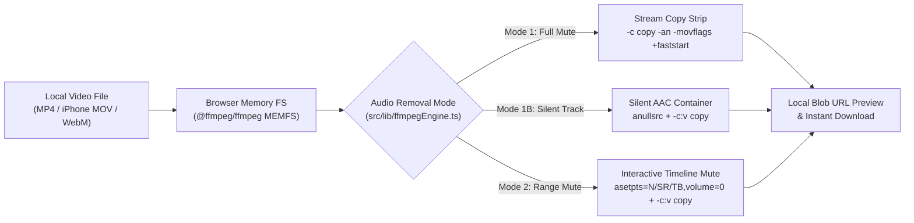

<div align="center">


# MuteVideo

**100% Client-Side Online Video Audio Remover — Strip Audio from MP4, iPhone MOV & WebM Clips in Browser RAM with Zero Cloud Uploads & No Watermark**

[Live App](https://mutevideo.github.io/) · [Features](#core-features--dual-mode-audio-removal-engine) · [Architecture](#system-architecture--processing-pipeline) · [Tech Stack](#tech-stack) · [Quick Start](#getting-started--cli-scripts) · [SEO & PWA](#pwa-technical-seo--google-search-console-indexing) · [Support](#support-the-developer)

<br />

[](https://mutevideo.github.io/)
[](https://astro.build/)
[](https://preactjs.com/)
[](https://tailwindcss.com/)
[](https://ffmpegwasm.netlify.app/)
[](#pwa-technical-seo--google-search-console-indexing)
[](#8-language-internationalization-i18n-routes)
[](./LICENSE)
[](https://kisharadilshan.gumroad.com/coffee)

</div>

---

## Table of Contents

- [Overview & Why MuteVideo](#overview--why-mutevideo)
- [Core Features & Dual-Mode Audio Removal Engine](#core-features--dual-mode-audio-removal-engine)
- [System Architecture & Processing Pipeline](#system-architecture--processing-pipeline)
- [Competitor Comparison Matrix](#competitor-comparison-matrix)
- [Tech Stack](#tech-stack)
- [Project Directory Structure](#project-directory-structure)
- [8-Language Internationalization (i18n) Routes](#8-language-internationalization-i18n-routes)
- [Color Palette & Design System Specification](#color-palette--design-system-specification)
- [Getting Started & CLI Scripts](#getting-started--cli-scripts)
- [PWA, Technical SEO & Google Search Console Indexing](#pwa-technical-seo--google-search-console-indexing)
- [GitHub Pages CI/CD Deployment](#github-pages-cicd-deployment)
- [Support the Developer](#support-the-developer)
- [License](#license)

---

## Overview & Why MuteVideo

Most online "mute video" websites require uploading 500 MB–2 GB MP4 or iPhone MOV files to third-party servers, queuing for remote transcoding, sacrificing pixel clarity through forced re-encoding, creating accounts, or stripping watermarks behind paywalls.

**MuteVideo** eliminates the server entirely:

- **Zero Cloud Uploads (`MEMFS` Execution):** Videos never leave your device. Processing runs inside browser memory via WebAssembly (`@ffmpeg/ffmpeg` + `@ffmpeg/core`).
- **Under-1-Second Lossless Stream Copy:** By remuxing video packets directly (`-c copy -an`) instead of decoding/re-encoding H.264/HEVC frames, MuteVideo strips audio virtually instantaneously with **zero quality loss** and **zero watermarks**.
- **Built-In Privacy & Offline Capability:** An offline-first Service Worker caches the static Astro shell and WebAssembly core (`ffmpeg-core.wasm`) so installed PWA users can mute clips even without an internet connection.

---

## Core Features & Dual-Mode Audio Removal Engine

### 1. Instant Full Mute (`-c copy -an`)

Removes the audio stream completely in under a second without touching video pixels, frame rate, HDR metadata, or bitrate:

```bash
ffmpeg -i input.mp4 -c copy -an -movflags +faststart output.mp4
```

- **Optional Silent AAC Track Container:** Strict social platforms (Instagram Reels, TikTok, YouTube Shorts) occasionally reject video-only files without an audio stream. MuteVideo provides a toggleable silent-track container mode using `anullsrc` while still keeping `-c:v copy` (zero video re-encoding):

```bash
ffmpeg -f lavfi -i anullsrc=channel_layout=stereo:sample_rate=44100 -i input.mp4 \
  -map 1:v:0 -map 0:a:0 -c:v copy -c:a aac -b:a 64k -shortest -movflags +faststart output.mp4
```

### 2. Interactive Timeline Range Mute (Mute Specific Time Section)

Silence an unwanted wind burst, background noise, or spoken segment between two timestamps while preserving the rest of the original audio and keeping video 100% lossless (`-c:v copy`):

- **Unified Timeline Range Bar** (`src/components/MuteVideoWorkspace.tsx`):
  - **Draggable Left & Right Handles** to trim start/end timestamps visually.
  - **Draggable Muted Window** to slide the selected duration across the timeline.
  - **Click-to-Seek Track & Live 50 ms Playhead Sync** paired with native video playback.
  - **Instant `▶` Range Preview** button and synced `Start` / `End` numeric second inputs.
- **Sample-Accurate FFmpeg Filter Pipeline** (`src/lib/ffmpegEngine.ts`):

```bash
ffmpeg -i input.mp4 -map 0:v:0 -map 0:a:0 \
  -af "asetpts=N/SR/TB,volume=enable='between(t,start,end)':volume=0" \
  -c:v copy -c:a aac -b:a 128k -movflags +faststart output.mp4
```

### 3. Additional Platform Capabilities

| Capability | Description |
| :--- | :--- |
| **Built-In Sample Video Generator** | Synthesizes a seekable `+faststart` MP4 clip with 440 Hz / 880 Hz audio pulses on the fly via FFmpeg WASM for one-click testing. |
| **Live Side-by-Side Playback Toggle** | Compare muted playback vs. original audio directly inside the workspace before exporting. |
| **Responsive Mobile & Tablet Navigation** | Collapsible icon-toggle drawer (`< 1024px`) keeping the hero video workspace cleanly centered above the fold (`100dvh`). |
| **Zero-Backend Static Output** | Compiles to pure HTML, CSS, ES modules, and static WASM assets deployable on GitHub Pages or any static CDN. |

---

## System Architecture & Processing Pipeline



---

## Competitor Comparison Matrix

| Feature | **MuteVideo** | Clideo | CapCut Web | Canva |
| :--- | :---: | :---: | :---: | :---: |
| **Price** | **100% Free Forever** | Freemium / Paywalled | Freemium | Freemium |
| **Watermark** | **None (Zero Watermark)** | Free tier adds watermark | Export restrictions apply | Template/asset gated |
| **Cloud Upload Required** | **No (100% Browser RAM)** | Yes (slow upload + server queue) | Yes (cloud project sync) | Yes (cloud editor) |
| **Processing Speed** | **Instant (~1s lossless copy)** | Slow (upload + encode + download) | Moderate–Slow | Slow |
| **Original Video Quality** | **100% Preserved (`-c copy`)** | Re-encoded compression | Re-encoded export | Re-encoded export |
| **Offline PWA Support** | **Yes (`sw.js` + WASM cache)** | No | No | No |
| **Account / Sign-Up** | **Not Required** | Optional / Upsell prompts | Required for many flows | Required |

---

## Tech Stack

| Layer | Technology | Version / Configuration | Purpose |
| :--- | :--- | :--- | :--- |
| **Static Framework** | [Astro](https://astro.build/) | `^7.4.11` | Zero-JS-by-default static HTML output (`output: 'static'`) for GitHub Pages. |
| **Interactive Island** | [Preact](https://preactjs.com/) + `@astrojs/preact` | `^11.2.0` / `^6.1.5` | Lightweight hydrated client island (`MuteVideoWorkspace.tsx`). |
| **Styling Engine** | [Tailwind CSS](https://tailwindcss.com/) + `@tailwindcss/vite` | `^4.3.5` | Utility styling + custom Sage/Cream/Charcoal Light & Dark CSS variables. |
| **WASM Video Engine** | `@ffmpeg/ffmpeg`, `@ffmpeg/core`, `@ffmpeg/util` | `^0.12.15` / `^0.12.10` / `^0.12.2` | In-browser FFmpeg execution synced locally under `public/ffmpeg/`. |
| **Sitemaps & SEO** | `@astrojs/sitemap` + custom `sitemap.xml.ts` | `^3.7.4` | Dual `sitemap.xml` & `sitemap-index.xml`, `hreflang` matrix, and zero-fake-rating JSON-LD. |
| **Analytics** | Google Tag Manager & GA4 | `GTM-T2S2F4H6` / `G-XZLLGR477Y` | Event instrumentation and traffic measurement. |
| **Type Checking** | `@astrojs/check` + `typescript` | `^0.9.6` / `^5.9.3` | Strict compile-time validation across `.astro`, `.ts`, and `.tsx` modules. |
| **CI/CD Hosting** | GitHub Actions + GitHub Pages | `withastro/action@v3` (Node 22) | Automated build and publish via `actions/deploy-pages@v4`. |

---

## Project Directory Structure

```text
mutevideo.github.io/
├── .github/
│   └── workflows/
│       └── deploy.yml              # GitHub Pages CI/CD pipeline (Node 22 + withastro/action@v3)
├── public/
│   ├── ffmpeg/                     # Auto-synced ffmpeg-core.js & ffmpeg-core.wasm (via sync-ffmpeg.mjs)
│   ├── .nojekyll                   # Prevents GitHub Pages Jekyll filtering
│   ├── favicon.svg                 # Crisp SVG app mark
│   ├── icon-maskable.svg           # Vector maskable PWA icon
│   ├── icon-192.png                # 192x192 PNG PWA icon
│   ├── icon-512.png                # 512x512 PNG PWA icon
│   ├── manifest.webmanifest        # PWA app metadata (standalone display, maskable icons)
│   ├── og-image.svg                # Social preview Open Graph graphic
│   ├── robots.txt                  # Crawler directives + dual Sitemap declarations
│   └── sw.js                       # Offline-first Service Worker (mutevideo-offline-v4)
├── scripts/
│   ├── generate-icons.mjs          # Generates 192x192 and 512x512 PNG icons
│   └── sync-ffmpeg.mjs             # Copies @ffmpeg/core WASM assets into public/ffmpeg/
├── src/
│   ├── components/
│   │   ├── Header.astro            # Desktop navbar, 8-lang switcher, theme toggle & <1024px drawer
│   │   ├── HomePage.astro          # Shared localized landing & workspace template
│   │   ├── JsonLdSchema.astro      # Strict WebApplication, HowTo, FAQPage & BreadcrumbList schema
│   │   └── MuteVideoWorkspace.tsx  # Preact island: file loader, preview, range timeline & export
│   ├── i18n/
│   │   ├── ui.ts                   # Complete localized dictionaries for all 8 languages
│   │   └── utils.ts                # Locale resolution, route builders & translation helpers
│   ├── layouts/
│   │   └── BaseLayout.astro        # Meta tags, canonical, hreflang network, OG/Twitter, GTM/GA4, SW reg
│   ├── lib/
│   │   └── ffmpegEngine.ts         # FFmpeg WASM singleton, full mute, silent track, range mute & sample gen
│   ├── pages/
│   │   ├── [lang]/
│   │   │   └── index.astro         # Localized static routes (/es/, /pt/, /de/, /fr/, /ja/, /zh/, /ru/)
│   │   ├── index.astro             # Root English route (/)
│   │   └── sitemap.xml.ts          # Direct URL-set sitemap for bulletproof GSC ingestion
│   └── styles/
│       └── global.css              # Design tokens, dark mode variables & base utility classes
├── astro.config.mjs                # Site URL, Preact integration, Sitemap config, Tailwind Vite plugin
├── LICENSE                         # MIT License (Copyright (c) 2026 Kishara Dilshan)
└── package.json                    # Dependencies and lifecycle scripts
```

---

## 8-Language Internationalization (i18n) Routes

Every localized route renders dedicated `<title>`, `<meta name="description">`, self-referencing `<link rel="canonical">`, `og:locale` alternates, structured JSON-LD, and full bidirectional `<link rel="alternate" hreflang="...">` tags (including `x-default`).

| Code | Language | Route Path | Production URL |
| :--- | :--- | :--- | :--- |
| `en` | English (Default) | `/` | `https://mutevideo.github.io/` |
| `es` | Español | `/es/` | `https://mutevideo.github.io/es/` |
| `pt` | Português | `/pt/` | `https://mutevideo.github.io/pt/` |
| `de` | Deutsch | `/de/` | `https://mutevideo.github.io/de/` |
| `fr` | Français | `/fr/` | `https://mutevideo.github.io/fr/` |
| `ja` | 日本語 | `/ja/` | `https://mutevideo.github.io/ja/` |
| `zh` | 中文 | `/zh/` | `https://mutevideo.github.io/zh/` |
| `ru` | Русский | `/ru/` | `https://mutevideo.github.io/ru/` |

---

## Color Palette & Design System Specification

MuteVideo uses a calm, distraction-free Sage / Cream / Charcoal palette tuned for video editing ergonomics:

| Design Token | Light Mode (Default) | Dark Mode | Role |
| :--- | :--- | :--- | :--- |
| **Primary Background** | `#FBF7F0` (Warm Cream Alabaster) | `#1E201F` (Deep Charcoal Dark) | Page canvas |
| **Surface Card** | `#FFFFFF` (Pure White) | `#2A2D2B` (Elevated Slate Dark) | Cards, panels & controls |
| **Workspace Highlight** | `#D9E4DD` (Soft Sage Mist) | `#242826` (Dark Sage Workspace) | Dropzone & active states |
| **Border / Divider** | `#CDC9C3` (Warm Greige Stone) | `#555555` (Charcoal Slate) | 1 px subtle separators |
| **Primary CTA Button** | `#555555` (`#3D3D3D` hover) | `#D9E4DD` (`#FBF7F0` hover) | Export / primary action |
| **Primary CTA Text** | `#FBF7F0` | `#1E201F` | High-contrast action labels |
| **Text Primary** | `#555555` | `#FBF7F0` | Headings & body copy |
| **Text Secondary** | `#6E6D6A` | `#CDC9C3` | Metadata & helper captions |

---

## Getting Started & CLI Scripts

### Prerequisites

- **Node.js** `20+` (CI builds on Node `22`)
- **npm** `10+`

### Local Development

```bash
# 1. Clone the repository
git clone https://github.com/mutevideo/mutevideo.github.io.git
cd mutevideo.github.io

# 2. Install dependencies (automatically runs `node scripts/sync-ffmpeg.mjs` via postinstall)
npm install

# 3. Start the local Astro development server
npm run dev
```

### Available CLI Scripts

| Command | Underlying Execution | Purpose |
| :--- | :--- | :--- |
| `npm run dev` | `node scripts/sync-ffmpeg.mjs && astro dev` | Syncs WASM core into `public/ffmpeg/` and starts hot-reload dev server. |
| `npm run check` | `astro check && tsc --noEmit` | Runs Astro diagnostics and strict TypeScript checking across the repo. |
| `npm run build` | `node scripts/sync-ffmpeg.mjs && astro build` | Produces static production output in `dist/` (HTML, bundles, sitemaps, PWA, WASM). |
| `npm run preview` | `astro preview` | Serves the compiled `dist/` bundle locally for production verification. |
| `node scripts/sync-ffmpeg.mjs` | Local script | Copies `@ffmpeg/core` JS & `.wasm` binaries into `public/ffmpeg/`. |
| `node scripts/generate-icons.mjs` | Local script | Regenerates `public/icon-192.png` and `public/icon-512.png` PWA icons. |

> **Note for Windows PowerShell 5.1 users:** Replace `&&` with `;` if chaining npm commands manually inside PowerShell 5.1.

---

## PWA, Technical SEO & Google Search Console Indexing

### Offline-First Progressive Web App

- **Web Manifest (`public/manifest.webmanifest`):** Configured for standalone installability with `#FBF7F0` background, `#555555` theme color, and SVG + PNG maskable icons (`192x192`, `512x512`).
- **Service Worker (`public/sw.js`):** Implements cache namespace `mutevideo-offline-v4` to keep HTML navigation and JavaScript fresh on network-first updates while pre-caching heavy `ffmpeg-core.js` and `ffmpeg-core.wasm` assets for reliable offline video muting.

### Bulletproof Google Search Console Sitemaps

To avoid occasional Google Search Console delays with nested sitemap indexes on GitHub Pages, MuteVideo ships **both** formats and declares both in `public/robots.txt`:

- Direct `<urlset>` sitemap (`src/pages/sitemap.xml.ts`) -> `https://mutevideo.github.io/sitemap.xml`
- Astro sitemap index (`@astrojs/sitemap`) -> `https://mutevideo.github.io/sitemap-index.xml`

```text
User-agent: *
Allow: /

Sitemap: https://mutevideo.github.io/sitemap.xml
Sitemap: https://mutevideo.github.io/sitemap-index.xml
```

### Structured Data & Compliance

- `src/components/JsonLdSchema.astro` emits valid `WebApplication`, `HowTo`, `FAQPage`, and `BreadcrumbList` JSON-LD graphs per locale.
- Strictly avoids fabricated `aggregateRating` or fake user review schemas in full compliance with Google Search structured data guidelines.

---

## GitHub Pages CI/CD Deployment

Every push to `main` (or manual `workflow_dispatch`) triggers [`.github/workflows/deploy.yml`](./.github/workflows/deploy.yml):

1. Checks out the repository and configures Node `22` via `withastro/action@v3`.
2. Installs dependencies and runs `npm run build` (syncing `@ffmpeg/core` and emitting `dist/` including `.nojekyll`).
3. Deploys the static `dist/` artifact to the `github-pages` environment via `actions/deploy-pages@v4`.

---

## Support the Developer

MuteVideo is 100% free, open-source, ad-free, watermark-free, and respects your privacy. If MuteVideo saved you time or bandwidth, consider buying a coffee:

<a href="https://kisharadilshan.gumroad.com/coffee">
  
</a>

---

## License

Released under the [MIT License](./LICENSE).  
Copyright (c) 2026 Kishara Dilshan (MuteVideo).
